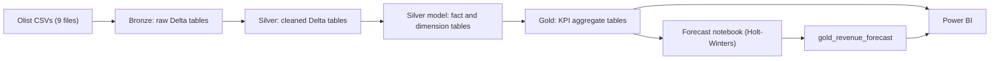

# Olist E-Commerce Analytics: PySpark, Delta Lake & Power BI


An end-to-end data analytics project built on a real-world e-commerce dataset. Raw CSVs are ingested, cleaned, modeled, aggregated and forecast with **PySpark**, stored in a **Delta Lake** medallion architecture (Bronze → Silver → Gold), and delivered to **Power BI** for dashboards and storytelling.

> **Transparency note:** this project was built in collaboration with an AI assistant (Claude, by Anthropic). See [AI-Assisted Development Disclosure](#ai-assisted-development-disclosure) for exactly what that means.

---

## Table of Contents

- [Project Status](#project-status)
- [Business Scenario & Goals](#business-scenario--goals)
- [Architecture](#architecture)
- [Tech Stack](#tech-stack)
- [Dataset](#dataset)
- [Repository Structure](#repository-structure)
- [Pipeline Walkthrough](#pipeline-walkthrough)
- [Data Model](#data-model)
- [Forecasting Approach](#forecasting-approach)
- [Power BI Layer](#power-bi-layer)
- [Getting Started](#getting-started)
- [Design Decisions](#design-decisions)
- [Known Limitations](#known-limitations)
- [Environment Troubleshooting Notes](#environment-troubleshooting-notes)
- [AI-Assisted Development Disclosure](#ai-assisted-development-disclosure)
- [Disclaimers](#disclaimers)
- [License & Attribution](#license--attribution)
- [Author](#author)

---

## Project Status

| Phase | Description | Status |
|---|---|---|
| 0 | Environment setup (PySpark + Delta Spark) | ✅ Complete |
| 1 | Bronze layer: raw ingestion with explicit schemas | ✅ Complete |
| 2 | Silver layer: cleaning and transformation | ✅ Complete |
| 3 | Silver model: star schema (fact + dimensions) | ✅ Complete |
| 4 | Gold layer: business KPI aggregates | ✅ Complete |
| 5 | Forecasting (Holt-Winters) | ✅ Complete |
| 6 | What-if analysis | 🚧 Planned (built natively in Power BI) |
| 7 | Power BI dashboard and storytelling | 🚧 In progress (data connected, visuals pending) |

This README will be updated as the Power BI phase is completed.

## Business Scenario & Goals

The project simulates the work of a data analyst at an online marketplace. The questions the pipeline is designed to answer:

- How is revenue trending over time, and what might the next few months look like?
- Which product categories and customer regions drive revenue?
- Does delivery speed relate to customer review scores?
- Which sellers perform best, and how are customers segmented by value and engagement?

The goal of the project is to demonstrate a complete analytics workflow across several tools: data modeling, cleaning, transformation, storage, linking, KPI design, forecasting, dashboarding, and storytelling.

## Architecture



The project follows the **medallion architecture**:

| Layer | Purpose | Location |
|---|---|---|
| Bronze | Raw data exactly as received, now versioned in Delta format | `delta/bronze/` |
| Silver | Cleaned, typed and standardized tables, plus the linked star schema | `delta/silver/` |
| Gold | Business-ready aggregates that Power BI reads directly | `delta/gold/` |

## Tech Stack

| Tool | Version | Role |
|---|---|---|
| Python | 3.11 | Notebook language |
| PySpark | 4.2.0 | Distributed data processing |
| Delta Lake (`delta-spark`) | 4.4.0 | ACID storage layer for every pipeline stage |
| pandas / statsmodels | latest at install time | Forecasting step (small time series) |
| Jupyter Notebook | n/a | Development environment |
| Power BI Desktop | n/a | Dashboards, visualization, what-if analysis |
| Conda (Anaconda) | n/a | Environment management (`pyspark-env`) |

Developed and tested on **Windows 11** with Spark running in local mode on a single machine.

## Dataset

**Brazilian E-Commerce Public Dataset by Olist**, available on Kaggle: <https://www.kaggle.com/datasets/olistbr/brazilian-ecommerce>

It contains roughly 100,000 anonymized orders placed between 2016 and 2018 across several Brazilian marketplaces, split across 9 relational tables:

| Table | Contents |
|---|---|
| `olist_orders_dataset` | One row per order, with status and key timestamps |
| `olist_order_items_dataset` | One row per product line item within an order |
| `olist_order_payments_dataset` | Payment records per order |
| `olist_order_reviews_dataset` | Customer review scores and comments |
| `olist_customers_dataset` | Customer identifiers and location |
| `olist_sellers_dataset` | Seller identifiers and location |
| `olist_products_dataset` | Product category and physical attributes |
| `olist_geolocation_dataset` | Zip-code prefix to latitude/longitude mapping |
| `product_category_name_translation` | Portuguese to English category names |

**The raw data is not included in this repository.** Download it from Kaggle (a free account is required) and review the dataset's license terms on its Kaggle page before use.

## Repository Structure

```
.
├── data/
│   └── raw/                         # Olist CSVs (download separately, not committed)
├── delta/                           # Generated by the notebooks (not committed)
│   ├── bronze/
│   ├── silver/                      # includes fact_order_items and dim_* tables
│   └── gold/
├── notebooks/
│   ├── spark_utils.py               # Shared SparkSession + Delta helper
│   ├── 01_bronze_ingestion.ipynb
│   ├── 02_silver_cleaning.ipynb
│   ├── 03_silver_linking_model.ipynb
│   ├── 04_gold_kpis.ipynb
│   └── 05_forecasting.ipynb
├── powerbi/                         # Planned: olist_ecommerce_analytics_dashboard.pbix
└── README.md
```

Each notebook reads from the previous layer's Delta tables and writes its own output, so stages can be re-run independently.

## Pipeline Walkthrough

### Shared helper: `spark_utils.py`
A single `get_spark_session(app_name)` function builds a SparkSession with Delta Lake's SQL extension and catalog enabled (using `configure_spark_with_delta_pip`). Every notebook imports it instead of repeating the setup.

### 01. Bronze ingestion
- Reads all 9 CSVs with **explicit schemas** (no `inferSchema`), which avoids an extra file scan and prevents type-guessing errors such as zip-code prefixes losing leading zeros.
- Writes each table, untouched, to `delta/bronze/<table_name>`.
- Reads one table back as a sanity check.

### 02. Silver cleaning
| Table | Cleaning applied |
|---|---|
| Customers, sellers | Trimmed and title-cased city names; exact duplicate rows removed |
| Geolocation | Standardized city names; collapsed to one row per zip prefix using averaged latitude/longitude |
| Order items, payments | Checked for negative price, freight and payment values (reported, not silently dropped) |
| Reviews | Added a `has_comment` flag, since most reviews contain a score only |
| Orders | Added `is_delivered` and `delivery_days` (null where an order was never delivered) |
| Products | Joined the English category translation; missing categories filled with `unknown` |
| Category translation | Passed through unchanged |

### 03. Silver linking and modeling
Builds the star schema described in [Data Model](#data-model). Payments and reviews are **aggregated to one row per order before joining**, so the fact table does not fan out. The notebook checks that `fact_order_items` has exactly the same row count as the source `order_items` table.

### 04. Gold KPIs
Builds the aggregate tables listed below. "Revenue" in this project means item `price` only, excluding freight.

| Gold table | Grain | Key metrics |
|---|---|---|
| `gold_monthly_revenue` | Year / month | Total revenue, order count, average order value |
| `gold_revenue_by_category` | Product category | Total revenue, order count |
| `gold_revenue_by_region` | Customer state | Total revenue, order count |
| `gold_delivery_by_category` | Product category | Average delivery days, average review score, order count |
| `gold_delivery_by_region` | Customer state | Average delivery days, average review score, order count |
| `gold_seller_performance` | Seller | Total revenue, order count, average review score |
| `gold_rfm_segments` | Customer (unique person) | Recency, frequency, monetary value, R/F/M quartile scores, segment |

**RFM segmentation** groups customers by `customer_unique_id` (the same person across orders, not the per-order `customer_id`). Recency is measured against the latest order date in the dataset, since the data is historical. Each metric is scored 1 to 4 with `ntile(4)` (4 is best), then mapped to a rule-based segment: Champions, Loyal Customers, At Risk, Lost, or New / Low Engagement. A rule table was chosen over a clustering model because it is easier to explain and audit.

### 05. Forecasting
See [Forecasting Approach](#forecasting-approach). Output: `gold_revenue_forecast`.

## Data Model

A star schema, written to `delta/silver/`:

| Table | Type | Description |
|---|---|---|
| `fact_order_items` | Fact | One row per order line item, with order status, delivery fields, order-level payment total and order-level review score |
| `dim_customers` | Dimension | Customers with latitude/longitude from the geolocation table |
| `dim_sellers` | Dimension | Sellers with latitude/longitude from the geolocation table |
| `dim_products` | Dimension | Products with English category name and physical attributes |
| `dim_date` | Dimension | Generated calendar covering the full order date range (year, month, quarter, day of week, weekend flag) |

## Forecasting Approach

The forecast projects monthly revenue six months beyond the last observed month.

- **Model:** Holt-Winters exponential smoothing (`statsmodels`) with an additive trend.
- **No seasonal component:** with under two years of clean history, there are not enough yearly cycles to estimate seasonality reliably, and forcing one would fit noise.
- **Trimming of unstable months:** months below an order-count threshold (`MIN_ORDER_COUNT`, default 50) are excluded, and the series is then trimmed to start after the last internal gap. Two early months (November and December 2016) had abnormally low order volume and left a hole in the series that otherwise made the model fit fail.
- **Confidence range:** 1,000 simulated future paths; the 10th and 90th percentiles form an 80% range around the mean forecast.
- **Why pandas here:** the monthly series is tiny, forecasting a single series does not need distributed compute, and PySpark has no built-in forecasting library. The result is written back to Delta so Power BI reads it like any other Gold table.

`gold_revenue_forecast` contains one row per month with `total_revenue` (actuals), `forecast_revenue`, `lower_bound`, `upper_bound`, and an `is_forecast` flag.

## Power BI Layer

Power BI Desktop connects directly to the Gold Delta tables using the native `DeltaLake.Table` Power Query function, with a single parameter holding the base path to `delta/gold/`. Reading through the Delta transaction log avoids picking up stale parquet files left behind by `overwrite` writes, which a plain folder or Parquet connector would include.

**Model relationships:** category tables are linked to each other, region tables are linked to each other, and monthly revenue is linked to the forecast on a month-start date. Seller and RFM tables are standalone.

**Planned dashboard pages:**
1. **Executive Overview:** KPI cards, monthly revenue trend, top categories
2. **Revenue Sources:** revenue by category and by state
3. **Delivery vs. Satisfaction:** relationship between delivery time and review score
4. **Customers, Sellers & Forecast:** RFM segments, top sellers, actual vs. forecast revenue

What-if analysis will be implemented with native Power BI What-if Parameters.

*Screenshots and key findings will be added here once the dashboard is complete.*

## Getting Started

### Prerequisites
- Anaconda or Miniconda
- Java (JDK 17 or later, per the Apache Spark 4.x requirements)
- Power BI Desktop (November 2023 release or later, for `DeltaLake.Table`)
- A free Kaggle account to download the dataset

### Setup

```bash
# Create an isolated conda environment on Python 3.11
conda create -n pyspark-env python=3.11

# Activate the environment
conda activate pyspark-env

# Install Spark, Delta Lake bindings, forecasting libraries and Jupyter
pip install pyspark==4.2.0 delta-spark==4.4.0 pandas statsmodels jupyter kaggle

# Download and unzip the Olist dataset into data/raw (requires Kaggle API credentials)
kaggle datasets download -d olistbr/brazilian-ecommerce -p data/raw --unzip
```

*(Lines starting with `#` are comments. Skip them if pasting into Windows Command Prompt.)*

### Run the pipeline

```bash
# From the project root, with the environment active, start Jupyter
jupyter notebook
```

Run the notebooks in `notebooks/` in order, each top to bottom:

1. `01_bronze_ingestion.ipynb`
2. `02_silver_cleaning.ipynb`
3. `03_silver_linking_model.ipynb`
4. `04_gold_kpis.ipynb`
5. `05_forecasting.ipynb`

Notebook paths are relative to `notebooks/` (for example `../data/raw` and `../delta/bronze`), so launch Jupyter so that the project layout matches the structure above.

### Connect Power BI
In Power BI Desktop, create a text parameter containing the absolute path to `delta/gold/`, then create one blank query per Gold table:

```
let
    // Open the folder of one Delta table (the folder containing its _delta_log subfolder)
    Source = Folder.Contents(GoldBasePath & "\gold_monthly_revenue"),
    // Read the table through the Delta transaction log (current version only)
    ToDelta = DeltaLake.Table(Source)
in
    ToDelta
```

Repeat for each table, changing only the folder name. If you clone this repository, update the base path parameter to your own location.

## Design Decisions

- **Explicit schemas over schema inference:** faster, safer, and serves as documentation of the data model.
- **Medallion layers with one notebook per stage:** stages can be re-run independently and are decoupled through Delta tables rather than shared in-memory state.
- **Aggregate before joining:** payments and reviews are reduced to order grain before joining to line items, to prevent row fan-out and inflated revenue.
- **Flag, don't drop:** legitimate nulls (undelivered orders, reviews without comments) are kept and flagged rather than removed or fabricated.
- **Rule-based RFM segments:** transparent and easy to explain.
- **Forecasting in Python, what-if in Power BI:** forecasting benefits from a documented, tunable model; what-if scenarios are interactive by nature and belong in the BI tool.
- **Pre-aggregated Gold tables kept as designed:** the project's focus is the end-to-end pipeline, so seller and RFM tables are intentionally all-time views and do not respond to date slicers.

## Known Limitations

- **Local, single-machine Spark.** The project demonstrates the patterns, not cluster-scale performance. There is no orchestration, scheduling, incremental loading or automated test suite; tables are rebuilt with `overwrite`.
- **Historical data (2016 to 2018).** RFM recency is relative to the dataset's last order date, not today.
- **Revenue excludes freight.** Order-level payment totals are repeated across the line items of an order in `fact_order_items`, so they should not be summed directly from that table.
- **Light city-name standardization.** Trimming and title-casing do not fix accent or spelling variants.
- **Geolocation is approximate.** Coordinates are averaged per zip-code prefix.
- **Short forecasting history.** Roughly two years of data, with unstable early months removed, gives a wide uncertainty range and no seasonality. The forecast is illustrative and not suitable for real business decisions.
- **Seller and RFM views are not time-filterable** (by design, see above).

## Environment Troubleshooting Notes

Documented here for anyone reproducing this on Windows 11:

- **numpy/pandas import blocked by Smart App Control.** Importing numpy failed with `An Application Control policy has blocked this file`, caused by Windows 11 Smart App Control blocking an unsigned math-library DLL (`libcblas.dll`). The author resolved it by turning Smart App Control off. **Caution:** disabling Smart App Control is a security trade-off and, per Microsoft's design, cannot be re-enabled without reinstalling Windows. A less drastic option, installing numpy and pandas from the Anaconda `defaults` channel (MKL-backed builds), was suggested but not tested by the author.
- **`DeltaLake.Table` requires a recent Power BI Desktop** (November 2023 or later).

## AI-Assisted Development Disclosure

This project was built in collaboration with **Claude**, an AI assistant developed by Anthropic, used through the claude.ai chat interface. In the interest of transparency, here is how the work was shared.

**Claude assisted with:**
- Recommending the dataset and the overall pipeline and medallion architecture
- Writing the code for `spark_utils.py` and all five notebooks, including the line-by-line comments
- Proposing cleaning rules, the star schema design, KPI definitions, the RFM scoring logic and the forecasting approach
- Diagnosing errors encountered along the way (statsmodels date-index and series-gap issues, the Windows Smart App Control block)
- Guidance on connecting Power BI to Delta tables, the dashboard page structure, and drafting this README

**The author:**
- Defined the project's goals and scope and chose the technology stack
- Set up the local environment, ran every notebook on their own machine, and checked outputs at each stage (for example, row-count matches between the source and fact tables)
- Made the project decisions, including which dataset to use, keeping forecasting in Python while moving what-if analysis to Power BI, and keeping the Gold tables as pre-aggregated views
- Is building and publishing the Power BI dashboard

**Please keep in mind:**
- AI-generated code can contain mistakes. The code here was validated by running it locally and inspecting outputs, but it has not been independently audited and has no formal test suite. Review it before reusing it.
- External facts about tools (version compatibility, Power BI features) were checked against public documentation at the time of writing and may change.
- Claude does not retain this project between conversations on its own; continuity came from the author sharing results and context.

## Disclaimers

- This project is for **educational and portfolio purposes only**. Nothing here is business, financial or investment advice, and the forecast should not be used for real decisions.
- The dataset is a public, anonymized sample provided by Olist. Findings describe this sample and may not generalize to any real business.
- This project is **not affiliated with, sponsored by, or endorsed by** Olist, Kaggle, Anthropic, Microsoft, the Apache Software Foundation, or the Delta Lake project. All product names and trademarks belong to their respective owners.

## License & Attribution

- **Code in this repository:** `[Choose a license, e.g. MIT, and add a LICENSE file]`
- **Dataset:** Olist, *Brazilian E-Commerce Public Dataset by Olist*, Kaggle, <https://www.kaggle.com/datasets/olistbr/brazilian-ecommerce>. The dataset is governed by its own license, so please check the terms on its Kaggle page. It is not redistributed in this repository.
- **Tools:** [Apache Spark](https://spark.apache.org/), [Delta Lake](https://delta.io/), [statsmodels](https://www.statsmodels.org/), [Microsoft Power BI](https://powerbi.microsoft.com/).

## Author

**[Your Name]**
[LinkedIn](https://www.linkedin.com/in/your-profile) · [GitHub](https://github.com/your-username)

*Feedback and suggestions are welcome via issues or pull requests.*
